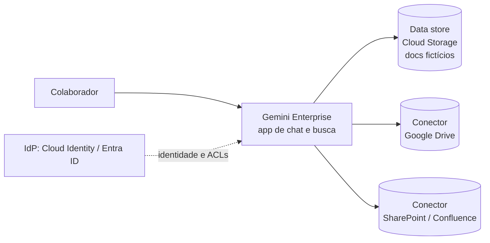

# ge-01 · Assistente de conhecimento corporativo

> **Status:** esqueleto com roteiro. **Duração:** ~15 min. **Público:** RH, Operações,
> TI, diretoria. **Tipo:** sem código.

## Resumo

- **Problema do cliente:** a informação da empresa está espalhada (Drive, SharePoint,
  Confluence, intranet) e os colaboradores perdem tempo procurando ou abrem chamado para
  perguntar coisas que já estão documentadas.
- **O que a demo mostra:** um único chat no Gemini Enterprise que busca em várias fontes
  ao mesmo tempo, responde com **citações** do documento de origem e **respeita as
  permissões** de cada usuário.
- **Mensagem-chave:** "Uma pergunta, todas as fontes, só o que você pode ver, com a fonte
  citada."

## Pré-requisitos

- Pré-requisitos comuns em [../README.md](../README.md#pré-requisitos-comuns).
- APIs: `discoveryengine.googleapis.com`, `storage.googleapis.com` (via `infra/`).
- Fontes de dados (pelo menos uma):
  - **Cloud Storage** com os documentos fictícios de [`data/`](data/) (sempre funciona), e/ou
  - Google Drive, Microsoft SharePoint Online, Confluence de um tenant **de demonstração**.
- Dois usuários de teste com permissões diferentes (ex.: `colaborador@` e `rh@`) para
  mostrar o controle de acesso.

## Arquitetura



## Preparação (antes da reunião)

1. Suba a infraestrutura:
   ```bash
   cd infra && cp terraform.example.tfvars terraform.tfvars  # preencha
   terraform init && terraform apply
   ```
2. No console do Gemini Enterprise, crie um app e adicione um **data store do Cloud
   Storage** apontando para o bucket do output `docs_bucket`.
3. (Opcional, mais impacto) conecte Drive e SharePoint/Confluence de demonstração.
   Coloque a política de trabalho remoto em uma fonte e o FAQ de benefícios em outra,
   para mostrar a resposta combinando fontes.
4. Restrinja `rh/reembolso-despesas.md` (na fonte que suportar ACL, como Drive/SharePoint)
   ao usuário `rh@`, para a etapa de permissões.
5. Aguarde a indexação terminar (pode levar de minutos a horas) e teste os prompts abaixo.

## Roteiro

| # | Tempo | Ação | O que falar |
|---|-------|------|-------------|
| 1 | 2 min | Mostre o "antes": três abas abertas (Drive, SharePoint, intranet) | "Hoje, para responder uma dúvida simples, a pessoa procura em três lugares." |
| 2 | 3 min | Pergunte: *"Quantos dias posso trabalhar de casa e quanto recebo de auxílio?"* | Destaque que a resposta junta duas informações e **cita o documento**. Clique na citação. |
| 3 | 3 min | Pergunte: *"Preciso de um monitor extra para home office, como peço?"* | A resposta cruza a política de RH com o catálogo de TI (fontes diferentes). |
| 4 | 3 min | Logado como `colaborador@`, pergunte o limite de hospedagem; depois repita como `rh@` | "O assistente só usa o que **essa pessoa** já pode ver. Nada de vazar documento restrito." |
| 5 | 2 min | Mostre o painel de administração: fontes conectadas, sincronização | "TI controla quais fontes entram, sem copiar dados para outro lugar." |
| 6 | 2 min | Fechamento | Sugira um piloto com 1 área e 2 fontes, medindo chamados evitados ao RH/TI. |

### Prompts sugeridos

- "Quantos dias posso trabalhar de casa e quanto recebo de auxílio?"
- "Posso trabalhar de outro país? Quem precisa aprovar?"
- "Qual o prazo para lançar um reembolso e qual o limite de alimentação em viagem?"
- "Resuma os benefícios para quem acabou de ser contratado, em formato de checklist."
- "Preciso de um monitor extra para home office, como peço?"

## Perguntas frequentes e objeções

- **"Os dados saem do meu ambiente / treinam o modelo?"** Os dados do cliente não são
  usados para treinar os modelos do Google; confirme os termos atuais na documentação
  de privacidade do Gemini Enterprise antes de afirmar detalhes contratuais.
- **"E se o documento estiver desatualizado?"** A resposta cita a fonte; a governança do
  conteúdo continua com o dono do documento. Conectores sincronizam periodicamente.
- **"Funciona com Microsoft 365?"** Sim, há conectores para SharePoint, OneDrive e
  Outlook, com identidade federada (ex.: Entra ID).
- **"Quanto custa?"** Licença por usuário, varia por edição. Leve a tabela vigente do
  parceiro, não o preço de lista de memória.

## Limpeza

```bash
cd infra && terraform destroy
```

Remova também, no console, o app e os data stores criados no Gemini Enterprise e
desconecte os conectores de terceiros.

## Status

- [x] Roteiro e prompts
- [x] Documentos fictícios em `data/`
- [x] Terraform (APIs + bucket com documentos)
- [ ] App do Gemini Enterprise montado no projeto de demo
- [ ] Conectores Drive e SharePoint de demonstração
- [ ] Ensaio gravado
