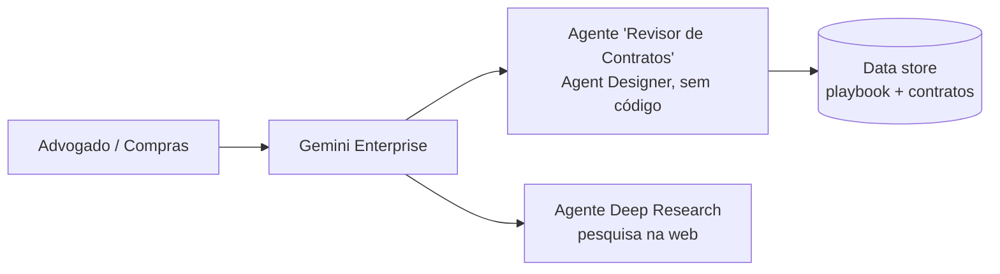

# ge-02 · Revisão de contratos e compliance

> **Status:** esqueleto com roteiro. **Duração:** ~20 min. **Público:** Jurídico,
> Compras, Compliance. **Tipo:** sem código (Agent Designer).

## Resumo

- **Problema do cliente:** o Jurídico gasta horas revisando contratos de fornecedores
  "padrão", o que atrasa Compras e deixa pouco tempo para os casos complexos.
- **O que a demo mostra:** um agente criado **sem código** no Agent Designer do Gemini
  Enterprise que lê o contrato, compara cada cláusula com o playbook da empresa e devolve
  uma tabela de riscos com sugestão de redação. Bônus: o agente pronto **Deep Research**
  para pesquisar jurisprudência ou regulação sobre uma cláusula.
- **Mensagem-chave:** "O agente faz a triagem em minutos; o advogado decide nos casos que
  importam."

## Pré-requisitos

- Pré-requisitos comuns em [../README.md](../README.md#pré-requisitos-comuns).
- Edição do Gemini Enterprise com **Agent Designer** habilitado (confira a edição).
- APIs: `discoveryengine.googleapis.com`, `storage.googleapis.com`, `aiplatform.googleapis.com`.
- Documentos fictícios de [`data/`](data/) em um data store (o Terraform sobe para um bucket).

## Arquitetura



## Preparação (antes da reunião)

1. `cd infra && cp terraform.example.tfvars terraform.tfvars && terraform init && terraform apply`
2. No Gemini Enterprise, crie um data store do Cloud Storage com o bucket `docs_bucket`
   e ligue ao app.
3. No **Agent Designer**, crie o agente com as instruções de
   [docs/instrucoes-agente.md](docs/instrucoes-agente.md) e associe o data store.
4. Teste com o contrato da RapidaFlux (muitos desvios) e o da BrilhoMax (quase tudo OK).
5. Deixe o PDF/MD do contrato da RapidaFlux no desktop para o momento do upload.

## Roteiro

| # | Tempo | Ação | O que falar |
|---|-------|------|-------------|
| 1 | 2 min | Mostre o playbook (tabela de 8 cláusulas) | "Toda empresa tem um playbook assim, mas aplicar à mão é lento." |
| 2 | 5 min | Abra o Agent Designer e mostre as instruções em português | "Isso foi escrito por alguém do Jurídico, sem programar. A regra de negócio é texto." |
| 3 | 5 min | Peça: *"Revise o contrato da RapidaFlux."* | Percorra a tabela: cada linha cita o contrato e o playbook. Mostre os ESCALAR. |
| 4 | 3 min | Peça: *"Revise o contrato da BrilhoMax."* | Contraste: contrato limpo, pode seguir sem o Jurídico. É aqui que se ganha tempo. |
| 5 | 3 min | Abra o Deep Research: *"Quais os riscos de um contrato de transporte sem cláusula de LGPD?"* | Pesquisa com fontes da web para embasar a negociação. |
| 6 | 2 min | Fechamento | Proponha piloto: 1 tipo de contrato, medir tempo de triagem antes e depois. |

### Prompts sugeridos

- "Revise o contrato da RapidaFlux."
- "Sugira uma redação para a cláusula de responsabilidade dentro do padrão do playbook."
- "Escreva um e-mail para o fornecedor pedindo os ajustes, em tom cordial."
- "Compare os dois contratos e diga qual tem mais risco e por quê."

## Perguntas frequentes e objeções

- **"E se o agente errar?"** Ele cita os trechos, então a revisão humana é rápida. A
  proposta é triagem, com decisão final do Jurídico. Mostre a divergência de
  classificação, se ocorrer, como argumento a favor da revisão humana.
- **"Contratos são confidenciais."** Os documentos ficam no projeto do cliente, com
  controle de acesso; use VPC Service Controls e CMEK se for exigência (confira o suporte
  atual na documentação).
- **"Dá para integrar com o nosso CLM?"** Sim, com conector (se houver) ou com um agente
  próprio em ADK (ver `ge-03`).

## Limpeza

```bash
cd infra && terraform destroy
```

Remova o agente do Agent Designer, o data store e o app no console.

## Status

- [x] Roteiro e prompts
- [x] Playbook e contratos fictícios com desvios
- [x] Instruções do agente para o Agent Designer
- [x] Terraform (APIs + bucket com documentos)
- [ ] Agente montado no projeto de demo
- [ ] Ensaio gravado
