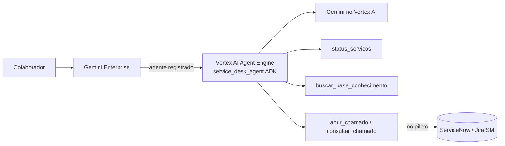

# ge-03 · Agente de service desk com ações

> **Status:** esqueleto funcional local (ADK) + roteiro. **Duração:** ~20 min.
> **Público:** TI, Suporte, arquitetura. **Tipo:** código (ADK + Agent Engine).

## Resumo

- **Problema do cliente:** o service desk recebe muitos chamados repetitivos (senha, VPN,
  equipamento) e o usuário não sabe se o problema já é um incidente conhecido.
- **O que a demo mostra:** um agente construído com o **ADK (Agent Development Kit)**,
  hospedado no **Vertex AI Agent Engine** e publicado no **Gemini Enterprise**, que
  consulta status de serviços, sugere solução da base de conhecimento e **abre chamados**
  (ação, não só resposta), pedindo confirmação antes.
- **Mensagem-chave:** "O Gemini Enterprise é a porta de entrada; os agentes de vocês,
  com as regras e sistemas de vocês, ficam do lado de dentro."

## Pré-requisitos

- Pré-requisitos comuns em [../README.md](../README.md#pré-requisitos-comuns).
- `uv`, `gcloud` e Python 3.11+.
- APIs (via `infra/`): Discovery Engine, Vertex AI, Cloud Run, Cloud Build,
  Artifact Registry, Cloud Storage.
- Edição do Gemini Enterprise que permita registrar agentes próprios (confira a edição).

## Arquitetura

Código: [`agent/service_desk_agent/`](agent/service_desk_agent/). Os dados das
ferramentas são **fictícios e em memória**; no piloto, troque o corpo de
[`tools.py`](agent/service_desk_agent/tools.py) por chamadas à API do ITSM.

## Preparação (antes da reunião)

Siga [docs/deploy.md](docs/deploy.md): teste local, deploy no Agent Engine e registro
no Gemini Enterprise. Tenha o `adk web` local aberto como plano B se a rede falhar.

## Roteiro

| # | Tempo | Ação | O que falar |
|---|-------|------|-------------|
| 1 | 2 min | Contexto: volume de chamados repetitivos | "Boa parte do service desk é triagem e resposta padrão." |
| 2 | 3 min | No Gemini Enterprise: *"Minha VPN não conecta."* | O agente vê o incidente conhecido no `sp-01` **antes** de sugerir o artigo KB-204. |
| 3 | 4 min | *"Não resolveu, pode abrir um chamado?"* | Ele propõe título/categoria/prioridade e **pede confirmação**. Confirme e mostre o número criado. |
| 4 | 2 min | *"Como está o chamado INC-1042?"* | Consulta o sistema (no piloto, o ITSM do cliente). |
| 5 | 5 min | Mostre o código: `agent.py` e `tools.py` | "São ~100 linhas. A instrução é texto; cada ferramenta é uma função Python documentada." |
| 6 | 2 min | Mostre o `adk web` com o trace das chamadas de ferramenta | Transparência: dá para auditar o que o agente fez e por quê. |
| 7 | 2 min | Fechamento | Piloto: 3 ferramentas ligadas ao ITSM real, medir taxa de resolução sem humano. |

### Prompts sugeridos

- "Minha VPN não conecta."
- "Esqueci a senha do e-mail."
- "Quero um monitor extra para trabalhar de casa."
- "Como está o chamado INC-1042?"
- "Algum sistema está fora do ar agora?"

## Perguntas frequentes e objeções

- **"E se o agente abrir chamado errado?"** A instrução exige confirmação antes de
  `abrir_chamado`; no piloto, a conta de serviço do agente tem permissão só para criar
  e consultar chamados.
- **"Precisa ser ADK?"** Não; o Agent Engine também suporta outros frameworks (como
  LangGraph). O ADK é o caminho mais direto no Google Cloud.
- **"Dá para conversar com outros agentes?"** Sim, via protocolo A2A, se o cliente já
  tiver agentes em outras plataformas.
- **"Onde roda e quanto custa?"** No Agent Engine (gerenciado), cobrado por uso de
  computação e de modelo. Estime com a calculadora oficial para o volume do cliente.

## Limpeza

Ver [docs/deploy.md](docs/deploy.md#5-limpeza).

## Status

- [x] Roteiro e prompts
- [x] Agente ADK com 4 ferramentas (dados fictícios)
- [x] Terraform (APIs)
- [x] Guia de deploy
- [ ] Deploy no Agent Engine do projeto de demo
- [ ] Registro no Gemini Enterprise
- [ ] Ensaio gravado
