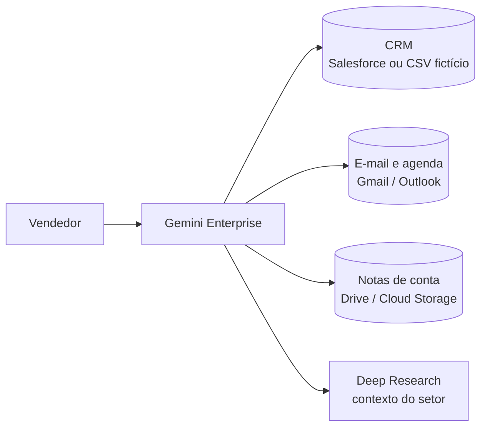

# ge-04 · Copiloto comercial

> **Status:** esqueleto com roteiro. **Duração:** ~15 min. **Público:** Vendas,
> Customer Success, diretoria comercial. **Tipo:** sem código (conectores + agentes prontos).

## Resumo

- **Problema do cliente:** vendedores gastam tempo juntando informação de CRM, e-mails e
  notas antes de cada reunião, e mesmo assim chegam sem saber o histórico completo.
- **O que a demo mostra:** no Gemini Enterprise, o vendedor pede um **brief da conta** e
  recebe, com citações, o resumo de oportunidades (CRM), últimas interações (e-mail e
  notas) e próximos passos; depois gera um **rascunho de proposta** e o e-mail de
  follow-up. Bônus: o agente **Deep Research** traz notícias e contexto do setor do cliente.
- **Mensagem-chave:** "Cada vendedor chega na reunião com o preparo do seu melhor vendedor."

## Pré-requisitos

- Pré-requisitos comuns em [../README.md](../README.md#pré-requisitos-comuns).
- Fontes (pelo menos uma):
  - **Cloud Storage** com o CRM fictício de [`data/`](data/) (sempre funciona), e/ou
  - Conector de CRM (ex.: Salesforce) e de e-mail/agenda (Gmail/Google Agenda ou
    Outlook) de um tenant **de demonstração**.
- APIs: `discoveryengine.googleapis.com`, `storage.googleapis.com` (via `infra/`).

## Arquitetura



## Preparação (antes da reunião)

1. `cd infra && cp terraform.example.tfvars terraform.tfvars && terraform init && terraform apply`
2. Crie um data store do Cloud Storage com o bucket `docs_bucket` e ligue ao app.
   (Opcional: conecte Salesforce e Gmail/Agenda de demonstração com dados equivalentes.)
3. Se usar agenda real, crie um evento "Apresentação de proposta – Varejo Aurora" para
   2026-11-18 com convidados fictícios.
4. Teste os prompts e confira se o brief cita as notas e o CSV.

## Roteiro

| # | Tempo | Ação | O que falar |
|---|-------|------|-------------|
| 1 | 2 min | Contexto: "quanto tempo seu time leva preparando uma reunião?" | Faça o cliente dizer o número; ele vira a métrica do piloto. |
| 2 | 4 min | *"Prepare um brief para minha reunião com a Varejo Aurora."* | Destaque as citações: CRM, e-mail e ligação aparecem juntos. Note a objeção de preço do concorrente. |
| 3 | 3 min | *"Monte um rascunho de proposta para a roteirização das 40 lojas, respondendo às preocupações da Marina."* | O rascunho usa o SLA de 98% e o rastreamento em tempo real como diferencial. |
| 4 | 2 min | *"Escreva o e-mail de follow-up para a Marina e o Paulo."* | Pronto para revisar e enviar. |
| 5 | 2 min | Deep Research: *"Tendências de logística no varejo de moda no Brasil para 2027."* | Contexto de mercado com fontes, para o vendedor abrir a conversa. |
| 6 | 2 min | Fechamento | Piloto com 1 time comercial, medir tempo de preparo e taxa de conversão. |

### Prompts sugeridos

- "Prepare um brief para minha reunião com a Varejo Aurora."
- "Quais oportunidades fecham este trimestre e qual o valor total?"
- "Quais riscos existem na conta Farma Celeste e o que preciso preparar para a Luiza?"
- "Monte um rascunho de proposta para a roteirização das 40 lojas."
- "Escreva o e-mail de follow-up para a Marina e o Paulo."

## Perguntas frequentes e objeções

- **"Já temos IA no CRM."** O diferencial é cruzar CRM com e-mail, agenda e documentos
  que estão fora do CRM, em uma só interface.
- **"Vendedor vai ver conta de outro vendedor?"** Com conectores que respeitam ACL, cada
  um vê só o que já tem permissão de ver no sistema de origem.
- **"Dá para escrever direto no CRM?"** Com ações de conector (quando disponíveis) ou com
  um agente próprio em ADK (ver `ge-03`).

## Limpeza

```bash
cd infra && terraform destroy
```

Remova o app, os data stores e desconecte os conectores de terceiros no console.

## Status

- [x] Roteiro e prompts
- [x] CRM fictício (CSV + notas de conta)
- [x] Terraform (APIs + bucket)
- [ ] App montado no projeto de demo
- [ ] Conectores Salesforce e e-mail de demonstração
- [ ] Ensaio gravado
