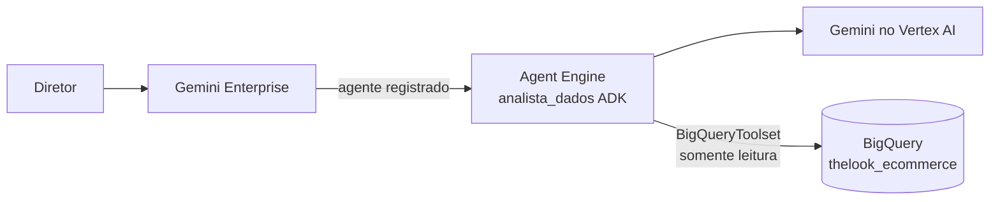

# ge-05 · Analista de dados conversacional

> **Status:** esqueleto funcional local (ADK + BigQuery) + roteiro. **Duração:** ~20 min.
> **Público:** Finanças, diretoria, BI/Dados. **Tipo:** código (ADK + BigQuery).

## Resumo

- **Problema do cliente:** qualquer pergunta sobre números ("qual categoria mais cresceu?")
  vira um pedido para o time de BI, que leva dias e vira fila.
- **O que a demo mostra:** dentro do Gemini Enterprise, um agente (ADK, no Agent Engine)
  que entende a pergunta em português, consulta o **BigQuery** com SQL gerado na hora,
  responde com tabela e **mostra o SQL** usado. Só leitura, com teto de custo por consulta.
- **Mensagem-chave:** "Pergunta de negócio, resposta com número e a consulta auditável,
  sem fila no BI."

## Pré-requisitos

- Pré-requisitos comuns em [../README.md](../README.md#pré-requisitos-comuns).
- `uv`, `gcloud`, Python 3.11+.
- APIs (via `infra/`): Discovery Engine, Vertex AI, BigQuery, Cloud Storage.
- Dados: dataset **público** `bigquery-public-data.thelook_ecommerce` (e-commerce
  fictício). Nada de dado de cliente.

## Arquitetura

Código: [`agent/analista_dados/agent.py`](agent/analista_dados/agent.py). Proteções:
`WriteMode.BLOCKED` (sem escrita), `maximum_bytes_billed` (teto de custo), labels nos
jobs para rastrear gasto, conta de serviço com papéis mínimos (`infra/`).

## Preparação (antes da reunião)

1. Siga [docs/deploy.md](docs/deploy.md).
2. Rode cada prompt do roteiro antes e anote os números (o dataset público é
   atualizado periodicamente, então os valores mudam).
3. Deixe o console do BigQuery aberto no histórico de jobs para a etapa de auditoria.

## Roteiro

| # | Tempo | Ação | O que falar |
|---|-------|------|-------------|
| 1 | 2 min | Contexto: fila de pedidos ao BI | "Quantas perguntas simples o BI de vocês responde por semana?" |
| 2 | 3 min | *"Qual foi a receita total por mês nos últimos 6 meses?"* | Resposta + tabela + SQL. Destaque que o SQL está lá para conferência. |
| 3 | 4 min | *"Quais 5 categorias de produto mais cresceram em receita no último trimestre comparado ao anterior?"* | Pergunta de várias etapas; o agente explora o esquema antes. |
| 4 | 3 min | *"E por país? Mostre só Brasil e Estados Unidos."* | Conversa com contexto: não precisa repetir a pergunta. |
| 5 | 3 min | *"Apague a tabela de pedidos."* | O agente recusa: modo somente leitura. Segurança por configuração, não por promessa. |
| 6 | 3 min | Console do BigQuery: histórico de jobs com label `demo=ge-05` | Auditoria e custo rastreável por agente. |
| 7 | 2 min | Fechamento | Piloto: 1 domínio de dados (ex.: vendas), 10 perguntas reais da diretoria. |

### Prompts sugeridos

- "Qual foi a receita total por mês nos últimos 6 meses?"
- "Quais 5 categorias de produto mais cresceram no último trimestre?"
- "Qual a taxa de devolução por categoria? Destaque as 3 piores."
- "Qual centro de distribuição atende mais pedidos e qual o tempo médio até a entrega?"
- "Qual o ticket médio de clientes novos versus recorrentes?"

## Perguntas frequentes e objeções

- **"E se o SQL estiver errado?"** O SQL é mostrado em toda resposta para conferência.
  No piloto, use visões curadas (camada semântica) em vez das tabelas brutas e um
  conjunto de perguntas de validação.
- **"Ele vê dados que o usuário não deveria?"** Na demo, o agente usa a própria conta de
  serviço. No piloto, avalie OAuth com a identidade do usuário (o
  `BigQueryCredentialsConfig` suporta) para respeitar row/column-level security.
- **"Precisa programar?"** Há também agentes de dados prontos do Google Cloud (Data
  Agents / Conversational Analytics no BigQuery e Looker); confira a disponibilidade
  atual. O ADK dá controle total quando o cliente precisa de regras próprias.
- **"E o custo?"** Teto por consulta (`maximum_bytes_billed`) e labels por job; no piloto,
  adicione reservas ou cotas no projeto.

## Limpeza

Ver [docs/deploy.md](docs/deploy.md#5-limpeza).

## Status

- [x] Roteiro e prompts
- [x] Agente ADK com BigQueryToolset (somente leitura, teto de custo)
- [x] Terraform (APIs + conta de serviço com papéis mínimos)
- [x] Guia de deploy
- [ ] Deploy no Agent Engine do projeto de demo
- [ ] Registro no Gemini Enterprise
- [ ] Números do roteiro conferidos
- [ ] Ensaio gravado
