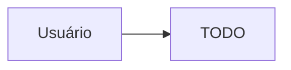

# {{ title }}

> **Status:** esqueleto. **Duração:** ~20 min. **Público:** TODO.

## Resumo

- **Problema do cliente:** TODO
- **O que a demo mostra:** TODO
- **Mensagem-chave:** TODO (uma frase que o cliente deve lembrar)

## Pré-requisitos

- Projeto Google Cloud dedicado à demo (nunca o ambiente do cliente).
- APIs: TODO
- Licenças / papéis IAM: TODO

## Arquitetura

## Preparação (antes da reunião)

1. TODO

## Roteiro

| # | Tempo | Ação | O que falar |
|---|-------|------|-------------|
| 1 | 2 min | Contexto do problema | TODO |
| 2 | 5 min | TODO | TODO |
| 3 | 3 min | Fechamento e próximos passos | TODO |

### Prompts sugeridos

- TODO

## Perguntas frequentes e objeções

- **TODO?** TODO

## Limpeza

TODO: como remover todos os recursos criados.

## Status

- [ ] Roteiro revisado
- [ ] Ambiente de demo montado
- [ ] Ensaio feito
